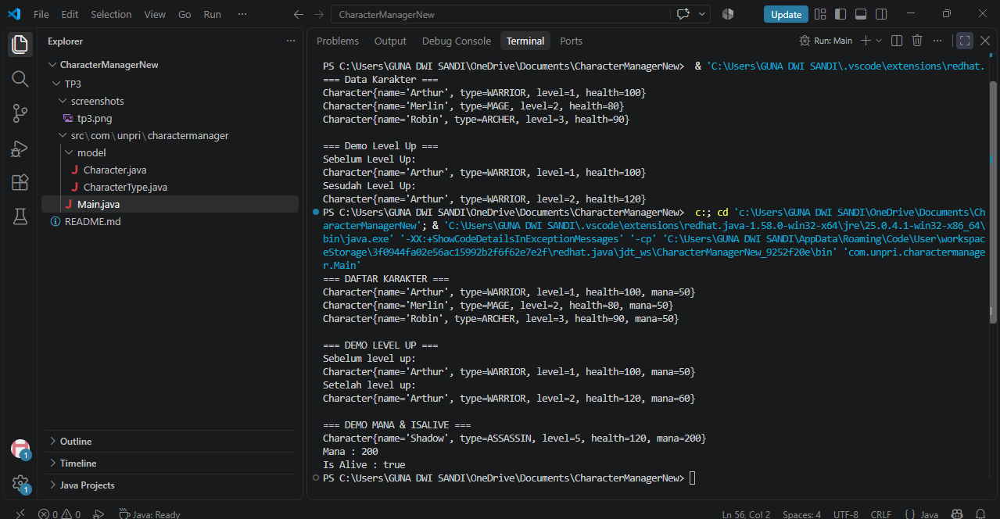

Character Manager — TP3 (Java Visual SIH-6406)

Deskripsi

Character Manager adalah aplikasi Java sederhana yang digunakan untuk mengelola data karakter game menggunakan konsep Object-Oriented Programming (OOP). Program ini mengimplementasikan class, enum, constructor, encapsulation, method, serta validasi data. Selain itu, aplikasi menyediakan fitur level up, mana, dan pengecekan status hidup karakter.

Contoh Output
()

Struktur Folder

CharacterManagerNew
│
├── src
│   └── com
│       └── unpri
│           └── charactermanager
│               ├── Main.java
│               └── model
│                   ├── Character.java
│                   └── CharacterType.java
│
└── README.md

Identitas Mahasiswa
Nama : Luna Tri Sandi
NIM : 253303621240
Google Docs Bagian D : [https://1drv.ms/w/c/265fce39944988d2/IQBSaEjTa1-HRouFOAIbQDK6Ab6l14r5AjI12270OtqmmGg?e=mf0aIq]