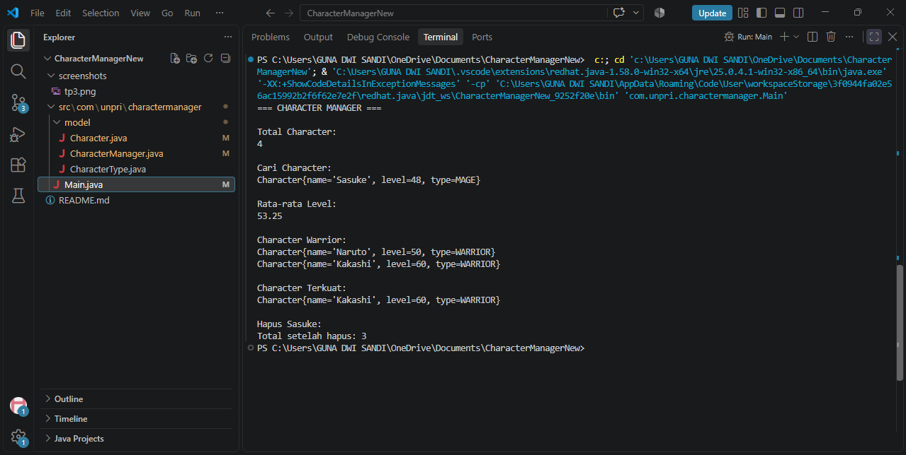

Character Manager — TP3 (Java Visual SIH-6406)

Deskripsi

Character Manager adalah aplikasi Java sederhana yang digunakan untuk mengelola data karakter game menggunakan konsep Object-Oriented Programming (OOP). Program ini mengimplementasikan class, enum, constructor, encapsulation, method, serta validasi data. Selain itu, aplikasi menyediakan fitur level up, mana, dan pengecekan status hidup karakter.

Hasil Output
()

Struktur Folder

CharacterManagerNew
│
├── src
│   └── com
│       └── unpri
│           └── charactermanager
│               ├── Main.java
│               └── model
│                   ├── Character.java
│                   └── CharacterType.java
│
└── README.md

Identitas Mahasiswa
Nama : Luna Tri Sandi
NIM : 253303621240
Google Docs Bagian D : [https://1drv.ms/w/c/265fce39944988d2/IQBSaEjTa1-HRouFOAIbQDK6Ab6l14r5AjI12270OtqmmGg?e=mf0aIq]

________________________________________________________________________________________________

Character Manager — TP5 (Java Visual SIH-6406)

Deskripsi Project

Character Manager adalah aplikasi sederhana berbasis Java yang digunakan untuk mengelola data karakter game. Project ini mengimplementasikan konsep Object-Oriented Programming (OOP) seperti class, object, encapsulation, collection, method overriding, dan enum.

Project ini dibuat untuk memenuhi tugas AP6 yang menggabungkan implementasi kode dan analisis konsep reference pada Java.

Fitur Bagian A
1. Add Character
Menambahkan karakter baru ke dalam sistem.

addCharacter(Character character)
Validasi
Karakter dengan nama yang sama tidak dapat ditambahkan dua kali.

Contoh:

manager.addCharacter(
    new Character("Naruto", 50, CharacterType.WARRIOR));

   2. Find Character By Name
Mencari karakter berdasarkan nama.

findByName(String name)
Contoh:

manager.findByName("Naruto");

 3. Remove Character
Menghapus karakter berdasarkan nama.

removeCharacter(String name)
Contoh:

manager.removeCharacter("Naruto");

4. Total Character
Mengembalikan jumlah karakter yang tersimpan.

getTotalCharacters()

5. Get All Characters
Mengembalikan salinan ArrayList karakter.

getAllCharacters()
Implementasi:

return new ArrayList<>(characters);
Penggunaan salinan list bertujuan menjaga encapsulation sehingga data internal tidak dapat diubah secara langsung dari luar class.

Fitur Bagian B
1. Average Level
Menghitung rata-rata level seluruh karakter.

getAverageLevel()
Jika list kosong maka method mengembalikan:

0
untuk menghindari error pembagian dengan nol.

2. Find By Type
Menampilkan seluruh karakter berdasarkan tipe tertentu.

findByType(CharacterType type)
Contoh:

manager.findByType(CharacterType.WARRIOR);
Fitur Bagian C
findStrongestCharacter()
Saya menambahkan fitur analitik baru bernama:

findStrongestCharacter()
Tujuan
Method ini digunakan untuk mencari karakter dengan level tertinggi dari seluruh data yang tersimpan.

Cara Kerja
Method mengecek apakah list kosong.

Jika kosong:

return null;
Jika tidak kosong:

Karakter pertama dijadikan kandidat awal.
Melakukan iterasi ke seluruh karakter.
Membandingkan level setiap karakter.
Karakter dengan level tertinggi akan dikembalikan.
Implementasi
public Character findStrongestCharacter() {

    if (characters.isEmpty()) {
        return null;
    }

    Character strongest = characters.get(0);

    for (Character character : characters) {

        if (character.getLevel() >
                strongest.getLevel()) {

            strongest = character;
        }
    }

    return strongest;
}
Alasan Pemilihan Fitur
Fitur ini berguna untuk analisis data karakter dan tidak mengubah data internal sistem sehingga tetap menjaga prinsip encapsulation.

Kompleksitas
Kompleksitas waktu:

O(n)
karena hanya melakukan satu kali perulangan pada seluruh data karakter.

Implementasi Encapsulation
Class CharacterManager menyimpan data menggunakan:

private ArrayList<Character> characters;
Data tidak dapat diakses langsung dari luar class.

Method:

getAllCharacters()
mengembalikan:

new ArrayList<>(characters);
bukan:

characters
sehingga perubahan pada list hasil tidak mempengaruhi data asli.

Implementasi Equals
Method equals() pada class Character dioverride untuk membandingkan nama karakter.

@Override
public boolean equals(Object obj)
Dengan demikian karakter dengan nama yang sama dianggap duplikat meskipun memiliki level atau tipe berbeda.

Contoh:

Naruto (Level 50)
Naruto (Level 90)
akan dianggap karakter yang sama.

Hasil Output

Struktur Project
com.unpri.charactermanager
│
├── Main.java
│
└── model
    ├── Character.java
    ├── CharacterManager.java
    └── CharacterType.java

Identitas Mahasiswa
Nama : Luna Tri Sandi
NIM : 253303621240
Google Docs Bagian D : [https://1drv.ms/w/c/265fce39944988d2/IQBhCxH4lz9DSb6pL-5FAL0sAfvzjrUEsdZ8RusYiMvnTYs?e=uZaojx]

