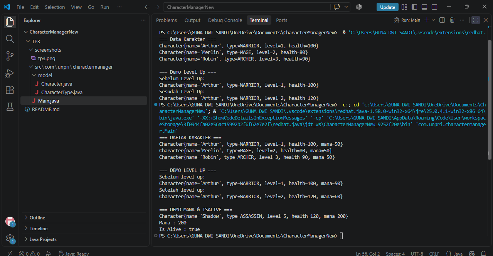
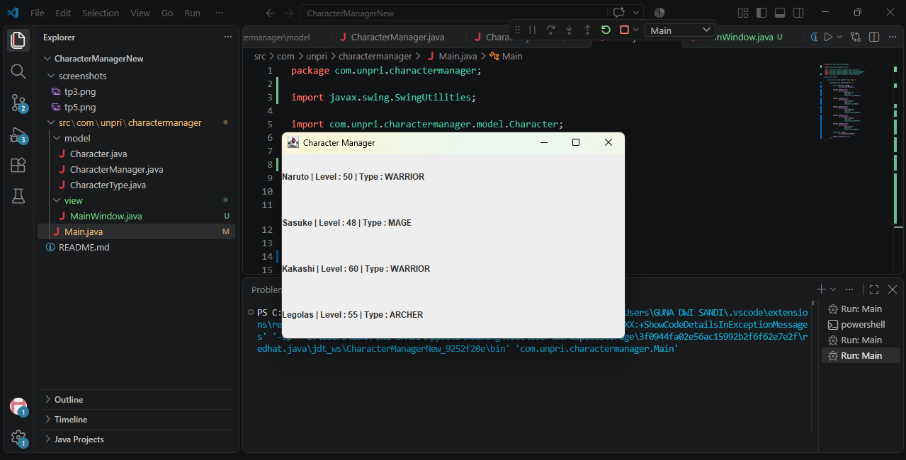
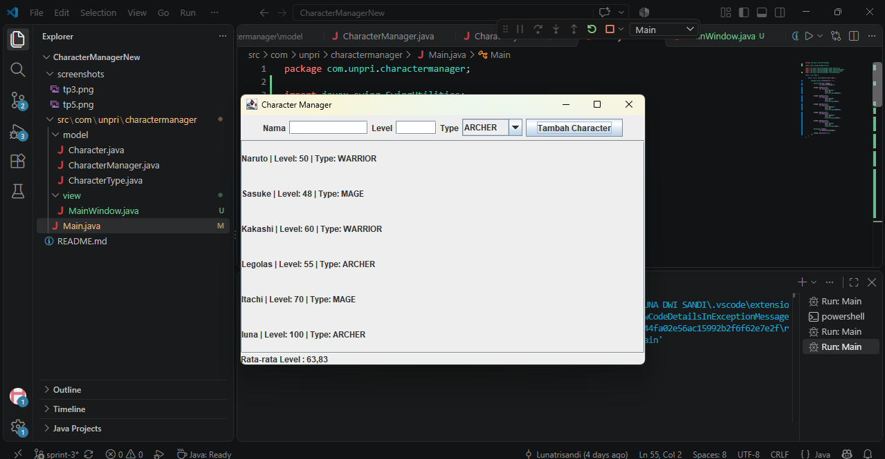
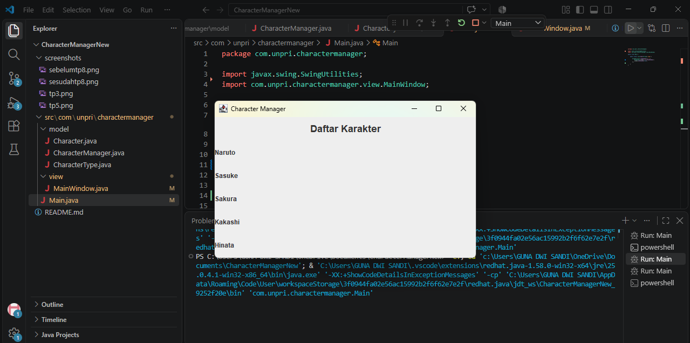
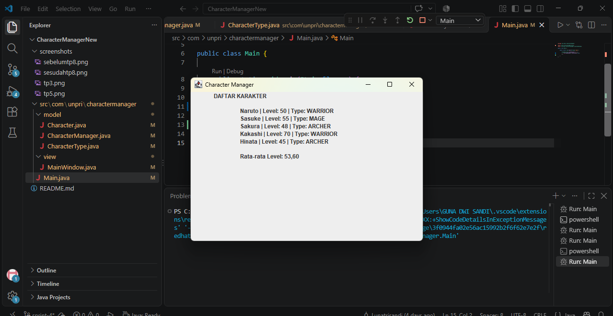

Character Manager — TP3 (Java Visual SIH-6406)

Deskripsi

Character Manager adalah aplikasi Java sederhana yang digunakan untuk mengelola data karakter game menggunakan konsep Object-Oriented Programming (OOP). Program ini mengimplementasikan class, enum, constructor, encapsulation, method, serta validasi data. Selain itu, aplikasi menyediakan fitur level up, mana, dan pengecekan status hidup karakter.

Hasil Output

Struktur Folder

CharacterManagerNew
│
├── src
│   └── com
│       └── unpri
│           └── charactermanager
│               ├── Main.java
│               └── model
│                   ├── Character.java
│                   └── CharacterType.java
│
└── README.md

Identitas Mahasiswa
Nama : Luna Tri Sandi
NIM : 253303621240
Google Docs Bagian D : [https://1drv.ms/w/c/265fce39944988d2/IQBSaEjTa1-HRouFOAIbQDK6Ab6l14r5AjI12270OtqmmGg?e=mf0aIq]

________________________________________________________________________________________________

Character Manager — TP5 (Java Visual SIH-6406)

Deskripsi Project

Character Manager adalah aplikasi sederhana berbasis Java yang digunakan untuk mengelola data karakter game. Project ini mengimplementasikan konsep Object-Oriented Programming (OOP) seperti class, object, encapsulation, collection, method overriding, dan enum.

Project ini dibuat untuk memenuhi tugas AP6 yang menggabungkan implementasi kode dan analisis konsep reference pada Java.

Fitur Bagian A
1. Add Character
Menambahkan karakter baru ke dalam sistem.

addCharacter(Character character)
Validasi
Karakter dengan nama yang sama tidak dapat ditambahkan dua kali.

Contoh:

manager.addCharacter(
    new Character("Naruto", 50, CharacterType.WARRIOR));

   2. Find Character By Name
Mencari karakter berdasarkan nama.

findByName(String name)
Contoh:

manager.findByName("Naruto");

 3. Remove Character
Menghapus karakter berdasarkan nama.

removeCharacter(String name)
Contoh:

manager.removeCharacter("Naruto");

4. Total Character
Mengembalikan jumlah karakter yang tersimpan.

getTotalCharacters()

5. Get All Characters
Mengembalikan salinan ArrayList karakter.

getAllCharacters()
Implementasi:

return new ArrayList<>(characters);
Penggunaan salinan list bertujuan menjaga encapsulation sehingga data internal tidak dapat diubah secara langsung dari luar class.

Fitur Bagian B
1. Average Level
Menghitung rata-rata level seluruh karakter.

getAverageLevel()
Jika list kosong maka method mengembalikan:

0
untuk menghindari error pembagian dengan nol.

2. Find By Type
Menampilkan seluruh karakter berdasarkan tipe tertentu.

findByType(CharacterType type)
Contoh:

manager.findByType(CharacterType.WARRIOR);
Fitur Bagian C
findStrongestCharacter()
Saya menambahkan fitur analitik baru bernama:

findStrongestCharacter()
Tujuan
Method ini digunakan untuk mencari karakter dengan level tertinggi dari seluruh data yang tersimpan.

Cara Kerja
Method mengecek apakah list kosong.

Jika kosong:

return null;
Jika tidak kosong:

Karakter pertama dijadikan kandidat awal.
Melakukan iterasi ke seluruh karakter.
Membandingkan level setiap karakter.
Karakter dengan level tertinggi akan dikembalikan.
Implementasi
public Character findStrongestCharacter() {

    if (characters.isEmpty()) {
        return null;
    }

    Character strongest = characters.get(0);

    for (Character character : characters) {

        if (character.getLevel() >
                strongest.getLevel()) {

            strongest = character;
        }
    }

    return strongest;
}
Alasan Pemilihan Fitur
Fitur ini berguna untuk analisis data karakter dan tidak mengubah data internal sistem sehingga tetap menjaga prinsip encapsulation.

Kompleksitas
Kompleksitas waktu:

O(n)
karena hanya melakukan satu kali perulangan pada seluruh data karakter.

Implementasi Encapsulation
Class CharacterManager menyimpan data menggunakan:

private ArrayList<Character> characters;
Data tidak dapat diakses langsung dari luar class.

Method:

getAllCharacters()
mengembalikan:

new ArrayList<>(characters);
bukan:

characters
sehingga perubahan pada list hasil tidak mempengaruhi data asli.

Implementasi Equals
Method equals() pada class Character dioverride untuk membandingkan nama karakter.

@Override
public boolean equals(Object obj)
Dengan demikian karakter dengan nama yang sama dianggap duplikat meskipun memiliki level atau tipe berbeda.

Contoh:

Naruto (Level 50)
Naruto (Level 90)
akan dianggap karakter yang sama.

Hasil Output

Struktur Project
com.unpri.charactermanager
│
├── Main.java
│
└── model
    ├── Character.java
    ├── CharacterManager.java
    └── CharacterType.java

Identitas Mahasiswa
Nama : Luna Tri Sandi
NIM : 253303621240
Google Docs Bagian D : [https://1drv.ms/w/c/265fce39944988d2/IQBhCxH4lz9DSb6pL-5FAL0sAfvzjrUEsdZ8RusYiMvnTYs?e=uZaojx]

________________________________________________________________________________________________

Character Manager — TP8 (Java Visual SIH-6406)

Deskripsi

Sebelum Penambahan Character
(Tambahkan screenshot sebelum menambah 2 character baru)

Contoh data:

Naruto (Level 50)
Sasuke (Level 48)
Kakashi (Level 60)
Rata-rata Level: 52.67

Sesudah Penambahan Character
(Tambahkan screenshot setelah menambah 2 character baru)

Contoh data:

Naruto (Level 50)
Sasuke (Level 48)
Kakashi (Level 60)
Legolas (Level 55)
Itachi (Level 70)
Rata-rata Level: 56.60

Aliran Data dan MVC
Program menggunakan pola MVC (Model-View-Controller) sederhana.

Class Main.java bertugas sebagai titik awal program. Pada class ini dibuat objek CharacterManager dan data karakter awal, kemudian objek tersebut dikirim ke MainWindow.

Class CharacterManager berperan sebagai Model yang menyimpan dan mengelola data karakter. Seluruh proses seperti menambah karakter, mencari karakter, menghitung rata-rata level, dan mengambil daftar karakter dilakukan pada class ini.

Class MainWindow berperan sebagai View yang bertugas menampilkan data ke antarmuka pengguna menggunakan Java Swing. Data karakter ditampilkan secara dinamis menggunakan perulangan dari hasil getAllCharacters().

Dengan pemisahan ini, logika pengelolaan data dan tampilan tidak tercampur sehingga program lebih mudah dikembangkan dan dipelihara.

Daftar Karakter dan Alasan Pemilihan
Nama	Level	Type	Alasan
Naruto	50	WARRIOR	Mewakili karakter petarung dengan level menengah
Sasuke	48	MAGE	Mewakili tipe karakter dengan kemampuan khusus
Kakashi	60	WARRIOR	Digunakan sebagai karakter berlevel tinggi
Legolas	55	ARCHER	Mewakili tipe pemanah
Itachi	70	MAGE	Digunakan untuk menguji fitur pencarian karakter terkuat
Karakter dipilih dengan level yang berbeda-beda agar perhitungan rata-rata level dan pencarian karakter terkuat dapat diuji dengan jelas.

Hasil Output Sebelum

Hasil Output Susudah

Struktur Project
CharacterManagerNew
│
├── screenshots
│   ├── tp3.png
│   └── tp5.png
│
├── src
│   └── com
│       └── unpri
│           └── charactermanager
│               │
│               ├── Main.java
│               │
│               ├── model
│               │   ├── Character.java
│               │   ├── CharacterManager.java
│               │   └── CharacterType.java
│               │
│               └── view
│                   └── MainWindow.java
│
└── README.md

Identitas Mahasiswa
Nama : Luna Tri Sandi
NIM : 253303621240
Google Docs Bagian D : [https://1drv.ms/w/c/265fce39944988d2/IQC1HpyTXEGJSZtj5abKaZnNAaQMmCg2ibE5ieK2FtdOLvI?e=dvvx9z]

________________________________________________________________________________________________
Character Manager — TP10 (Java Visual SIH-6406)

Deskripsi

Implementasi MainWindow
Pada TP11, aplikasi Character Manager dikembangkan dari aplikasi console menjadi aplikasi GUI menggunakan Java Swing. GUI dibuat menggunakan class MainWindow yang berada pada package view dan mewarisi (extends) class JFrame.

Jendela aplikasi memiliki title bar, ukuran yang sesuai, serta menggunakan setDefaultCloseOperation(JFrame.EXIT_ON_CLOSE) agar aplikasi tertutup dengan benar saat tombol close ditekan.

Implementasi Dinamis
Data karakter tidak ditampilkan menggunakan JLabel yang dibuat satu per satu secara manual. Seluruh data ditampilkan secara dinamis menggunakan perulangan terhadap data yang tersimpan di CharacterManager.

Contoh:

for (Character character : manager.getAllCharacters()) {

    JLabel label = new JLabel(
            character.getName()
            + " | Level : "
            + character.getLevel()
            + " | Type : "
            + character.getType());

    listPanel.add(label);
}
Dengan pendekatan ini, setiap penambahan karakter baru akan otomatis muncul pada tampilan GUI tanpa perlu menambahkan JLabel baru secara manual.

Penggunaan SwingUtilities.invokeLater()
Class Main.java menggunakan:

SwingUtilities.invokeLater(() -> {
    MainWindow window = new MainWindow(manager);
    window.setVisible(true);
});
Penggunaan SwingUtilities.invokeLater() memastikan seluruh komponen GUI dibuat dan dijalankan pada Event Dispatch Thread (EDT) sesuai praktik yang direkomendasikan pada Java Swing.

Arsitektur MVC
Struktur aplikasi mengikuti pola MVC (Model View Controller) sederhana.

Main
 │
 ▼
CharacterManager (Model)
 │
 ▼
MainWindow (View)
Model
Model terdiri dari:

Character
CharacterType
CharacterManager
Model bertanggung jawab menyimpan dan mengelola data karakter.

View
View direpresentasikan oleh:

MainWindow
View bertugas menampilkan data karakter dan statistik rata-rata level kepada pengguna.

Controller
Controller diwujudkan melalui event listener pada tombol GUI.

Contoh:

btnTambah.addActionListener(e -> tambahCharacter());
Ketika tombol ditekan, event akan memanggil method yang memproses data dan memperbarui tampilan.

Event Driven Programming
Aplikasi menggunakan konsep event-driven programming. Program tidak berjalan secara berurutan seperti aplikasi console, melainkan menunggu aksi pengguna.

Contoh event:

Klik tombol Tambah Character
Memilih Character Type
Menutup jendela aplikasi
Setiap event akan memicu kode tertentu melalui event listener yang telah didaftarkan pada komponen GUI.

Hasil Output Sebelum tp10

Hasil Output Sesudah tp10

Struktur Project
CharacterManagerNew
│
├── screenshots
│   ├── tp3.png
│   └── tp5.png
│
├── src
│   └── com
│       └── unpri
│           └── charactermanager
│               │
│               ├── Main.java
│               │
│               ├── model
│               │   ├── Character.java
│               │   ├── CharacterManager.java
│               │   └── CharacterType.java
│               │
│               └── view
│                   └── MainWindow.java
│
└── README.md

Identitas Mahasiswa
Nama : Luna Tri Sandi
NIM : 253303621240
Google Docs Bagian D : [https://1drv.ms/w/c/265fce39944988d2/IQC1HpyTXEGJSZtj5abKaZnNAaQMmCg2ibE5ieK2FtdOLvI?e=dvvx9z]